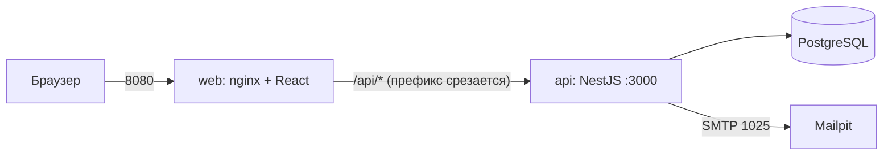
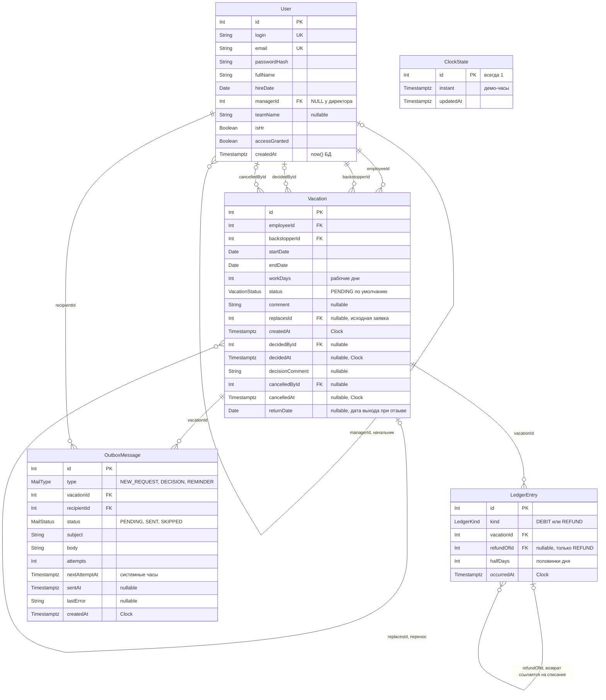
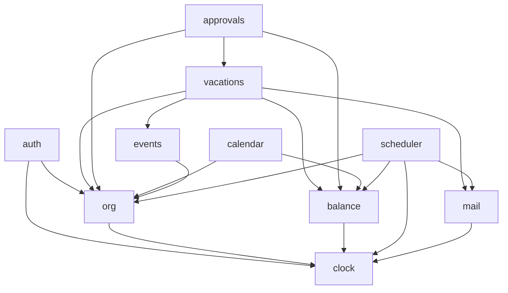

# architecture.md — архитектура сервиса «Отпуска»

> **Статус:** S1-b, версия от 2026-10-23. Документ согласован со схемой S1-a ([schema.prisma](apps/api/prisma/schema.prisma), миграция [s1_data_model](apps/api/prisma/migrations/20261023163539_s1_data_model/migration.sql)) и с [RULES.md](docs/RULES.md).
> **Источник правды по бизнес-логике:** [docs/RULES.md](docs/RULES.md). Ссылки `§N-k` читаются так же, как в тестах: `k` — порядковый номер пункта верхнего уровня в разделе `N` (вложенные пункты относятся к родителю). Всё, чего в RULES нет, помечено «проектное решение» и перечислено в [разделе 13](#13-проектные-решения-и-известные-ограничения).
> Кода в S1-b нет: документ задаёт контракт для этапов S2–S8.

## Содержание

1. [Обзор и время](#1-обзор-и-время)
2. [Модель данных](#2-модель-данных)
3. [Ограничения БД и что остаётся приложению](#3-ограничения-бд-и-что-остаётся-приложению)
4. [Модули](#4-модули)
5. [Согласующий и видимость](#5-согласующий-и-видимость)
6. [Политика блокировок](#6-политика-блокировок)
7. [Контракт API](#7-контракт-api)
8. [Каталог ошибок](#8-каталог-ошибок)
9. [События и SSE](#9-события-и-sse)
10. [Планировщик и outbox](#10-планировщик-и-outbox)
11. [Сценарии и строки БД](#11-сценарии-и-строки-бд)
12. [Стек и обоснование](#12-стек-и-обоснование)
13. [Проектные решения и известные ограничения](#13-проектные-решения-и-известные-ограничения)

---

## 1. Обзор и время



- Клиент и сервер раздельные сервисы Docker Compose (postgres, mailpit, api, web). Все порты опубликованы только на `127.0.0.1`.
- Пути API ниже даны **от корня api**. Браузер обращается к ним с префиксом `/api` (nginx срезает его). `GET /health` остаётся в корне api и вне контракта.
- `proxy_buffering off` и увеличенный `proxy_read_timeout` в nginx заданы заранее под SSE.

### Источники времени (RULES §1, §9)

| Что | Источник | Где |
|---|---|---|
| «Сегодня», начисление 1-го числа, 09:00, «в прошлом», «начался» | `Clock` + `COMPANY_TZ` | вся бизнес-логика |
| `createdAt` заявки, `decidedAt`, `cancelledAt`, `LedgerEntry.occurredAt`, `OutboxMessage.createdAt` | `Clock` (БД без DEFAULT) | сервисы |
| `OutboxMessage.nextAttemptAt`, `sentAt`, паузы повторов, опрос диспетчера | системные часы | диспетчер outbox |
| Срок JWT (8 ч) | системные часы | auth |
| `User.createdAt` | `now()` БД (технический) | БД |
| Календарные даты (`startDate`, `endDate`, `hireDate`, `returnDate`) | тип `DATE`, в API строка `YYYY-MM-DD` | везде |
| Моменты | `timestamptz`, в API ISO-8601 UTC | везде |

- **Clock** ([clock.ts](apps/api/src/clock/clock.ts)): `now(): Promise<Date>` (асинхронный, потому что в демо-режиме значение читается из БД); `SystemClock`, `FakeClock` (тесты), `DbClock` ([db-clock.ts](apps/api/src/clock/db-clock.ts)): читает строку `ClockState` при каждом вызове (без кэша) и при отсутствии создаёт её значением реального момента (`INSERT ... ON CONFLICT DO NOTHING`, параллельные первые вызовы дают одну строку, RULES §9-2). `DbClock` не зависит от Nest, его использует и seed. Выбор реализации — в `ClockModule`: `DEMO_MODE` строго `"true"` даёт `DbClock`, иначе `SystemClock`, сохранённое значение игнорируется. «Сегодня» — `companyToday(now, tz)` от момента, который дал Clock (проектное решение S3-a, DECISIONS).
- «День» момента определяется по `COMPANY_TZ`: `2026-12-31T18:00Z` — это 1 января в Бишкеке (тест [dates.int.spec.ts](apps/api/src/db/dates.int.spec.ts)).
- Prisma возвращает `DATE` как `Date` в полночь UTC; в домене даты — строки `YYYY-MM-DD`.
- Дни в домене и журнале — целое число **половинок дня** (`halfDays`). `Vacation.workDays` — целые рабочие дни заявки, `halfDays = workDays × 2`. В API дни — число, кратное 0,5 (точно представимо в JSON).

Переменные окружения (compose): `COMPANY_TZ` (по умолчанию `Asia/Bishkek`), `REMINDER_DAYS` (3), `DEMO_MODE` (демо только при строгом `"true"`), `JWT_SECRET` (демо-значение), `DATABASE_URL`.

---

## 2. Модель данных

### ER-диаграмма



Перечисления: `VacationStatus` = `PENDING` («На согласовании»), `APPROVED` («Одобрена»), `REJECTED` («Отклонена»), `CANCELLED` («Отменена»), `REPLACED` («Заменена переносом»); `LedgerKind` = `DEBIT`, `REFUND`; `MailType` = `NEW_REQUEST`, `DECISION`, `REMINDER`; `MailStatus` = `PENDING`, `SENT`, `SKIPPED` (напоминание, ставшее неактуальным к моменту отправки, §8-3).

### Таблицы

**User** — сотрудник и учётная запись.

| Поле | Смысл | RULES |
|---|---|---|
| `login`, `email` (UNIQUE) | вход и адрес письма; seed: `<login>@vacation.local` | §7-1, §8 |
| `passwordHash` | хеш пароля | §7-1 |
| `hireDate` | дата выхода; от неё считаются начисления; меняет только HR | §2, §6-1 |
| `managerId` | непосредственный руководитель; `NULL` только у директора | §4-1, §4-2 |
| `teamName` | «Фронт-отдел» / «Бэк-отдел»; у остальных `NULL`; задаёт seed | §7-6 |
| `isHr` | флаг HR; роли «руководитель» и «сотрудник» вычисляются из структуры | §7-1 |
| `accessGranted` | «доступ получен»: ставится при первом успешном входе, никогда не снимается | §6-7 |

**Выбор `teamName` вместо таблицы `Team`:** профиль показывает только название команды без списка членов, состав команд задаёт только seed (§7-3, §7-6), справочник команд не нужен.

**Vacation** — заявка и отпуск (одна сущность).

| Поле | Смысл | RULES |
|---|---|---|
| `employeeId`, `backstopperId` | сотрудник и заменяющий; заменяющий не равен сотруднику | §3-3 |
| `startDate`, `endDate`, `workDays` | период и число рабочих дней (≥ 1, один календарный год) | §3-4 |
| `status` | см. перечисление | §3-11 |
| `comment` | необязателен; обязателен для начала «в прошлом» | §3-7, §3-8 |
| `replacesId` | заявка-перенос ссылается на исходную; цепочка A→B→C | §5-2, §5-12 |
| `decidedById/At`, `decisionComment` | кто и когда решил (для директора — HR) | §4 |
| `cancelledById/At`, `returnDate` | отмена; дата выхода при отзыве | §5-4, §5-5, §5-11 |

**LedgerEntry** — журнал: только списания и возвраты. Начисления и обрезки 15 дней на 1 января **вычисляются** из `hireDate` (§6-6).

| Поле | Смысл |
|---|---|
| `kind = DEBIT` | списание при окончательном согласовании; `halfDays > 0`; без `refundOfId`; одно на заявку |
| `kind = REFUND` | возврат при отмене или отзыве; `halfDays ≥ 0` (0 допустим при выходе в выходной); `refundOfId` — **списание корня цепочки**; один на заявку |
| `vacationId` | заявка, чьё действие породило запись (для возврата — отменённое звено цепочки) |
| `occurredAt` | момент по Clock; определяет порядок относительно обрезки 1 января (§6-6) |

**OutboxMessage** — очередь писем. Ключ уникальности `(type, vacationId, recipientId)` (§8-3). `nextAttemptAt` и `sentAt` по системным часам, `createdAt` по Clock.

**ClockState** — одна строка (`id = 1`): демо-часы, общие для api, планировщика и `seed:demo` (§9-2).

### Производные величины (в БД не хранятся)

| Что | Как получается |
|---|---|
| Баланс сегодня | свёртка: начисления до сегодня включительно (из `hireDate`), обрезки 1 января, все `DEBIT` и `REFUND`; порядок дня: начисление, обрезка, действия (§6-6) |
| «Доступно на D» | баланс сегодня + начисления и обрезки строго после сегодня и до D включительно (§3-10) |
| Роль «руководитель» | у пользователя есть подчинённые (`managerId = его id`) |
| Директор | `managerId IS NULL` |
| «Перенос на рассмотрении» у отпуска | отпуск `APPROVED` и существует заявка с `replacesId = его id` в статусе `PENDING` (§3-11) |
| «Старый отпуск остаётся» у заявки-переноса | `replacesId IS NOT NULL` и статус `REJECTED` или `CANCELLED` (§3-11) |
| Корень цепочки | заявка без `replacesId`, достижимая по `replacesId` (§5-12) |
| Дата напоминания | N-й рабочий день назад от `startDate` (§8-3) |

---

## 3. Ограничения БД и что остаётся приложению

### Что гарантирует БД

Имена ограничений используются в [constraints.int.spec.ts](apps/api/src/db/constraints.int.spec.ts); их наличие проверяет [migration.int.spec.ts](apps/api/src/db/migration.int.spec.ts); дрейф миграции от схемы ловит `db:drift` в CI.

| Ограничение | Правило | RULES | Тест |
|---|---|---|---|
| `User_single_root_idx` (partial UNIQUE) | не больше одного пользователя без начальника | §4-2 | второй пользователь без начальника не проходит |
| `User_not_own_manager_chk` | не собственный начальник | §4-1 | пользователь не может быть собственным начальником |
| `Vacation_dates_order_chk` | начало ≤ конца | §3-4 | начало позже конца не проходит |
| `Vacation_one_year_chk` | один календарный год | §3-4 | заявка через Новый год не проходит |
| `Vacation_work_days_chk` | `workDays ≥ 1` | §3-4 | заявка без рабочих дней не проходит |
| `Vacation_backstopper_not_self_chk` | заменяющий не заявитель | §3-3 | сам себе backstopper не проходит |
| `Vacation_not_replaces_self_chk` | заявка не заменяет саму себя | §5-12 | — (прямого теста нет) |
| `Vacation_no_approved_overlap_excl` (EXCLUDE gist) | нет пересечения `APPROVED` одного сотрудника | §3-4, §5-2 | пересекающиеся одобренные отпуска не проходят |
| `Vacation_single_live_successor_idx` (partial UNIQUE) | у отпуска один действующий преемник (`PENDING` или `APPROVED`) | §5-2 | второй ожидающий перенос не проходит |
| `LedgerEntry_kind_shape_chk` | форма записи: списание без ссылки и `> 0`, возврат со ссылкой и `≥ 0` | §6-6, §6-8 | списание с нулём; возврат без ссылки |
| `LedgerEntry_one_debit_per_vacation_idx` | одно списание на заявку | §10-1 | второе списание по той же заявке не проходит |
| `LedgerEntry_one_refund_per_vacation_idx` | один возврат на заявку | §6-8, §10-1 | повторный возврат по той же заявке не создаётся |
| триггер `LedgerEntry_refund_guard` (функция `ledger_refund_guard`) | возврат ссылается на списание **корня** цепочки своей заявки; сумма возвратов ≤ списанного; `FOR UPDATE` на списание сериализует параллельные возвраты | §5-12, §6-8 | возврат сверх списанного отклоняется; возврат к списанию промежуточного звена или чужой цепочки отклоняется; два параллельных возврата по одному списанию: проходит один |
| `OutboxMessage_type_vacationId_recipientId_key` | одно письмо на «тип + отпуск + получатель» | §8-3 | дубль письма «тип + отпуск + получатель» не проходит |
| `OutboxMessage_attempts_chk` | `attempts ≥ 0` | §8 | — |
| `ClockState_single_row_chk` | `id = 1` | §9-2 | состояние демо-часов — одна строка |
| внешние ключи `ON DELETE RESTRICT` | записи не удаляются каскадом | — | — |

Порядок утверждения переноса важен для `EXCLUDE`: в одной транзакции сначала старый отпуск `APPROVED → REPLACED`, затем новый `PENDING → APPROVED` (обратный порядок БД отклоняет, тест «обратный порядок утверждения»).

### Что БД не гарантирует и делает приложение

| Правило | RULES | Где проверяется |
|---|---|---|
| «Хотя бы один» пользователь без начальника | §4-2 | seed и тест (S3) |
| Пересечение заявок в статусе `PENDING` (с любой активной, кроме переносимого отпуска) | §3-4, §5-2 | `vacations`, под блокировкой сотрудника |
| Достаточность остатка при подаче и при согласовании | §3-9, §4-3 | `balance` + `vacations`/`approvals`, под блокировкой |
| `workDays` и `endDate` соответствуют датам (рабочие дни пн–пт) | §1 | `vacations`, чистая функция S2 |
| «В прошлом»: начало в текущем году, комментарий обязателен | §3-7 | `vacations` |
| Подача до первого начисления | §3-6 | `vacations` |
| Перенос: то же число рабочих дней, начало не раньше сегодня, только до начала, исходная `APPROVED` | §5-1, §5-2 | `vacations` |
| Статус и журнал согласованы (`APPROVED` ⇔ есть списание, отмена ⇒ возврат) | §6-6 | сервисные транзакции |
| Отзыв: `returnDate` между началом и окончанием включительно, `halfDays` возврата | §5-5, §5-6, §5-11 | `vacations` |
| Старый отпуск нельзя отменить/отозвать/перенести, пока перенос `PENDING` | §5-2, §5-3 | `vacations` |
| `replacesId` пишется один раз при создании и не меняется | §5-12 | приложение (в БД нет запрета; от этого зависит чтение цепочки до блокировки, [раздел 6](#6-политика-блокировок)) |
| Кто может действовать (согласующий, HR, владелец) | §4, §5, §7 | guards, `approverOf`, `visibleTo` |
| Состав получателей писем и отсутствие писем при отмене | §8 | `mail` |
| Проверка статуса `APPROVED` в момент отправки напоминания | §8-3 | диспетчер outbox |

---

## 4. Модули



Слой **домена** (S2) — чистые функции без БД и Nest: рабочие дни, начисление, обрезка, свёртка журнала, «доступно на D», дни возврата, дата напоминания, проверки формы заявки. Модули ниже вызывают домен и работают с БД.

| Модуль | Ответственность | Владеет таблицами | Публичный интерфейс | Этап |
|---|---|---|---|---|
| **clock** | единственный источник «сейчас»; демо-часы в БД; установка часов | `ClockState` | `await Clock.now()`, `DbClock.set(instant)`, `companyToday(now, tz): YYYY-MM-DD` по `COMPANY_TZ` | S0, S3 |
| **auth** | вход по логину и паролю, JWT (8 ч, системные часы), guard, признак `accessGranted` | — (читает/пишет `User`) | `login()`, `JwtGuard`, `@Roles()` | S3 |
| **org** | структура: руководитель, подчинённые, роли, `approverOf`, `visibleTo`, справочник | `User` | `rolesOf(user)`, `approverOf(employee)`, `visibleTo(viewer)`, `canSee(viewer, employeeId)`, `directory()` | S3 |
| **balance** | журнал и баланс: чтение свёртки, запись списания и возврата | `LedgerEntry` | `balanceToday(employee)`, `availableOn(employee, D)`, `debit(tx, vacation)`, `refund(tx, vacation, halfDays)` | S2, S4–S6 |
| **vacations** | подача, статусы, отмена, отзыв, перенос, списки по видимости | `Vacation` | `submit()`, `cancel()`, `recall()`, `submitTransfer()`, `list(viewer)`, `get(viewer, id)` | S4, S6 |
| **approvals** | экран и решение согласующего, повторная проверка остатка, предупреждения о пересечениях | — | `pending(approver)`, `approve()`, `reject()`, `overlapWarnings()` | S5 |
| **mail/outbox** | постановка писем в очередь в транзакции, диспетчер отправки и повторов | `OutboxMessage` | `enqueue(tx, message)`, `Dispatcher` (по системным часам) | S4 |
| **scheduler** | напоминания: идемпотентный проход по Clock, создаёт только строки outbox | — | `pass()` | S7 |
| **calendar** | read-model календаря: только `APPROVED`, по `visibleTo` | — | `calendar(viewer, from, to)` | S5 |
| **events** | шина доменных событий и SSE-эндпоинт | — | `publish(event)`, `GET /events` | контракт S1; шина S5; SSE S8 |

Правила взаимодействия:

- Сервисная операция выполняется в **одной транзакции**: смена статуса, запись журнала, строки outbox. `TxHook` `onVacationApproved(tx, vacation)` вызывается внутри транзакции одобрения и утверждения переноса: в S5 он создаёт письмо о решении, в S7 добавляет немедленное напоминание.
- События шины публикуются **после коммита** (`publish` вне транзакции). Потеря события при падении процесса допустима (известное ограничение).
- Модули не обращаются к таблицам друг друга напрямую, только через интерфейсы. Исключение: чтение через общий `PrismaService` внутри одной транзакции.

---

## 5. Согласующий и видимость

### Роли

| Роль | Признак |
|---|---|
| HR | `isHr` |
| Руководитель | есть прямые подчинённые |
| Сотрудник | остальные |
| Директор | `managerId IS NULL` (обычный руководитель; его заявки согласует HR) |

Каждый пользователь, включая руководителя и HR, подаёт заявки **как сотрудник**. HR в системе один (инвариант проверяет seed, как для директора).

### Согласующий (RULES §4-1, §4-2)

```text
approverOf(employee) = employee.managerId != null ? manager(employee) : HR
```

- Заявка сотрудника, руководителя, заместителя и HR: непосредственный руководитель (заявки HR согласует заместитель директора).
- Заявка директора: HR («допуск HR»). То же для заявки-переноса.
- Действие согласующего выполняет только `approverOf(vacation.employee)`. Если согласующий совпадает с автором заявки (HR вызывает решение по своей заявке), ответ `403 APPROVE_OWN_REQUEST`; для любого другого пользователя `403 NOT_APPROVER`.
- Письмо о новой заявке уходит `approverOf(employee)`; письмо о решении — `employee` (§8-2).

### Предупреждение о пересечениях (RULES §4-6; DECISIONS 2026-10-22)

Набор сотрудников: `owner = employee.managerId ?? employee.id`, `team = {owner} ∪ прямые подчинённые owner`. Берутся только отпуска `APPROVED` на пересекающиеся даты (кроме самой заявки и заменяемого переносом отпуска). Согласование не блокируется.

### `visibleTo(viewer)` — единая функция для REST и SSE (RULES §7-2)

```text
scope(viewer) =
  viewer.isHr                 ->  ALL                      (все сотрудники)
  viewer имеет подчинённых    ->  { viewer } ∪ direct(viewer)
  иначе                       ->  { viewer }

canSee(viewer, employeeId) = employeeId ∈ scope(viewer)
```

Команда руководителя — только прямые подчинённые, вложенные не входят (§7-3). Заместитель директора видит себя и своих подчинённых; директор — себя и заместителя.

| Ресурс | Кто видит | Фильтр |
|---|---|---|
| Заявки (список, карточка) | сотрудник свои; руководитель свои и прямых подчинённых; HR все (чтение, все статусы) | `canSee(viewer, vacation.employeeId)`; иначе `404` |
| Заявки на согласование | `approverOf(employee) = viewer`, статус `PENDING` | HR видит здесь только заявки директора |
| Календарь | сотрудник себя; руководитель подчинённых и себя; HR всех; **только `APPROVED`** | `canSee` + `status = APPROVED` |
| Остаток | свой; руководитель — подчинённых; HR — всех | `canSee` |
| Профиль | только свой | `/me` |
| Справочник | любой вошедший: `id` + имя, без самого себя | — |
| Заявка, где я backstopper | **не видна**: роль заменяющего прав на просмотр не даёт | только `canSee` по сотруднику заявки |
| SSE-событие | зрителю, для которого `canSee(viewer, event.employeeId)` | то же условие на сервере |

`scope(viewer)` вычисляется на каждый запрос и каждое событие по актуальной структуре; в JWT только `sub` (проектное решение).

---

## 6. Политика блокировок

Цель: RULES §10-1 — проверка пересечений и остатка и смена статуса атомарны, из двух параллельных запросов проходит один, письмо и списание ровно одни.

**Единый порядок захвата:** `User` (сотрудник, чья заявка) → `Vacation` по **возрастанию id** → строка списания `LedgerEntry`. Ни одна транзакция не берёт более одной строки `User`, поэтому порядок между сотрудниками не нужен.

**Режим блокировки `User` и `Vacation` — `FOR NO KEY UPDATE`, не `FOR UPDATE`.** Вставка заявки проверяет внешние ключи и берёт `FOR KEY SHARE` на строки `employee`, `backstopper`, `decidedBy`. `FOR UPDATE` конфликтует с ним: если Иван указал Марию заменяющей, а Мария Ивана, их одновременные подачи блокируют друг друга (проверено на Postgres: `40P01 deadlock detected`). `FOR NO KEY UPDATE` с `KEY SHARE` не конфликтует, а два запроса на одного сотрудника по-прежнему выстраиваются в очередь.

Все записи журнала по сотруднику идут под его строкой `User`, поэтому остаток читается внутри блокировки без гонок.

| Операция | Блокировки (по порядку) | Записи в той же транзакции |
|---|---|---|
| Подача заявки | `User(employee)` | проверка пересечений `PENDING`/`APPROVED` и остатка; `Vacation`; `OutboxMessage(NEW_REQUEST)` |
| Подача переноса | `User(employee)` → `Vacation(исходная)` | проверки §5-2; `Vacation(replacesId)`; `OutboxMessage(NEW_REQUEST)` |
| Согласование/отклонение | `User(employee)` → `Vacation` по id: для переноса `{replacesId, id}` | повторная проверка статуса («уже обработана»); для обычной — остаток, `status`, `DEBIT`; для переноса — порядок: старый `REPLACED`, затем новый `APPROVED`; `OutboxMessage(DECISION)`; хук |
| Отмена сотрудником `APPROVED` | `User(employee)` → вся цепочка по возрастанию id → списание (триггер) | `status = CANCELLED`, `REFUND(refundOfId = списание корня)` |
| Отмена `PENDING`, отмена переноса | `User(employee)` → `Vacation` | `status = CANCELLED`; возврата нет |
| Отзыв HR | `User(employee)` → вся цепочка по id → списание (триггер) | `status = CANCELLED`, `returnDate`, `REFUND` |
| Смена даты выхода | `User(employee)` | `hireDate`; журнал не трогается |
| Диспетчер outbox | `OutboxMessage ... FOR UPDATE SKIP LOCKED` | `status`, `attempts`, `nextAttemptAt` |
| Планировщик | нет блокировок сущностей | `INSERT ... ON CONFLICT DO NOTHING` |

Правила:

1. **Цепочка читается до блокировки.** `replacesId` пишется один раз при создании ([раздел 3](#что-бд-не-гарантирует-и-делает-приложение)), поэтому набор звеньев можно прочитать без блокировки, затем захватить звенья по возрастанию id (звено-преемник всегда создаётся позже предшественника, его id больше) и перечитать статусы.
2. **После захвата всё перечитывается**: статус заявки, наличие преемника в `PENDING`, баланс. Если статус уже не допускает действия, ответ `409 ALREADY_PROCESSED`.
3. **Триггер возврата** берёт `FOR UPDATE` на списание корня последним — это продолжение того же порядка, взаимных блокировок нет (на списание ссылаются только записи той же цепочки, то есть того же сотрудника).
4. **Все вставки в outbox** идут с `ON CONFLICT DO NOTHING`, а несколько строк одной операции вставляются одним запросом по возрастанию `recipientId`. Это исключает и дубль письма, и взаимную блокировку по уникальному ключу между транзакцией одобрения и проходом планировщика (оба могут вставить `REMINDER` по одному отпуску).
5. **Нарушение ограничений БД** как последняя линия: `23P01` (EXCLUDE) → `VACATION_OVERLAP`; `23505` на `Vacation_single_live_successor_idx` → `TRANSFER_ALREADY_PENDING`; `23505` на списании/возврате → `ALREADY_PROCESSED`; `23514` триггера → внутренняя ошибка (баг приложения).
6. Остаточная гонка: диспетчер проверяет статус `APPROVED` перед отправкой без блокировки отпуска; отмена, пришедшая между проверкой и отправкой, не остановит уже отправляемое письмо (описано в [разделе 13](#13-проектные-решения-и-известные-ограничения)).

---

## 7. Контракт API

Базовые соглашения:

- Авторизация: заголовок `Authorization: Bearer <JWT>`. Токен нигде, кроме заголовка, не передаётся (в URL нет).
- Даты — `YYYY-MM-DD`, моменты — ISO-8601 UTC, дни — число, кратное 0,5 (может быть отрицательным только после сдвига даты выхода, §6-4).
- «Сегодня» и все расчёты даёт сервер (по Clock); браузер своё время не используется.
- Ошибки — единый формат `Problem` ([раздел 8](#8-каталог-ошибок)).
- Списки без постраничной разбивки (объём демо).

### Доступ по маршрутам

«Любой» — любой вошедший пользователь. «Согласующий» — `approverOf(employee)`. «Владелец» — сотрудник заявки.

| Маршрут | Доступ | RULES | Этап |
|---|---|---|---|
| `POST /auth/login` | публичный | §7-1, §6-7 | S3 |
| `GET /config` | публичный | §9-2 | S3 |
| `GET /me` | любой | §7-2 | S3 |
| `GET /clock`, `PUT /clock` | любой вошедший, **только при `DEMO_MODE`**, иначе `404` | §9-2, §9-3 | S3 |
| `GET /employees` | любой | §3-3 | S4 |
| `GET /me/balance` | любой | §3-10, §7-2 | S4 |
| `GET /employees/{id}/balance` | руководитель (подчинённые), HR (все) | §7-2 | S5 |
| `POST /vacations` | любой, у кого уже есть начисление | §3, §10-1 | S4 |
| `GET /vacations` | любой (`mine`); руководитель (`team`); HR (`all`) | §7-2 | S4 |
| `GET /vacations/{id}` | видимость `canSee` | §7-2 | S4 |
| `GET /approvals` | руководитель, HR | §4-7 | S5 |
| `POST /vacations/{id}/approve`, `.../reject` | согласующий | §4-1, §4-2 | S5 |
| `POST /vacations/{id}/cancel` | владелец, до начала | §5-4, §5-7 | S6 |
| `POST /vacations/{id}/recall` | HR, после начала | §5-5 | S6 |
| `POST /vacations/{id}/transfer` | владелец, до начала | §5-1, §5-2 | S6 |
| `GET /hr/balances` | HR | §7-2 | S6 |
| `PATCH /employees/{id}/hire-date` | HR | §6-1 | S6 |
| `GET /calendar` | любой (по `scope`) | §7-2 | S5 |
| `GET /events` | любой (SSE, по `scope`) | §10-2 | S8 |

### OpenAPI

```yaml
openapi: 3.0.3
info:
  title: Отпуска
  version: "1.0"
  description: Контракт API сервиса. Пути даны от корня api (браузер добавляет префикс /api).
servers:
  - url: /
security:
  - bearerAuth: []
tags:
  - { name: auth }
  - { name: balance }
  - { name: vacations }
  - { name: approvals }
  - { name: hr }
  - { name: calendar }
  - { name: events }
  - { name: demo-clock }
paths:
  /auth/login:
    post:
      tags: [auth]
      security: []
      summary: Вход по логину и паролю
      description: >
        Сначала проверяются логин и пароль, затем дата выхода по Clock:
        без признака accessGranted и при hireDate позже сегодняшней даты вход запрещён.
        При успехе ставится accessGranted = true.
      requestBody:
        required: true
        content:
          application/json:
            schema:
              type: object
              required: [login, password]
              properties:
                login: { type: string }
                password: { type: string }
      responses:
        "200":
          description: Токен на 8 часов (системные часы)
          content:
            application/json:
              schema:
                type: object
                required: [accessToken, expiresAt]
                properties:
                  accessToken: { type: string }
                  expiresAt: { type: string, format: date-time }
        "401": { $ref: "#/components/responses/Problem" }   # AUTH_INVALID_CREDENTIALS
        "403": { $ref: "#/components/responses/Problem" }   # AUTH_NOT_HIRED_YET
  /config:
    get:
      tags: [demo-clock]
      security: []
      summary: Публичная конфигурация
      responses:
        "200":
          description: OK
          content:
            application/json:
              schema:
                type: object
                required: [demoMode, companyTz]
                properties:
                  demoMode: { type: boolean }
                  companyTz: { type: string, example: Asia/Bishkek }
  /clock:
    get:
      tags: [demo-clock]
      summary: Текущее значение часов (только DEMO_MODE=true, иначе 404)
      responses:
        "200": { $ref: "#/components/responses/Clock" }
        "404": { $ref: "#/components/responses/Problem" }
    put:
      tags: [demo-clock]
      summary: Установить демо-часы (только DEMO_MODE=true, иначе 404)
      description: >
        Дата и время передаются в часовом поясе компании (COMPANY_TZ), сервер сам переводит их в момент UTC
        (браузер часовыми поясами не занимается; форма подставляет время 09:00 по умолчанию, RULES §9-3).
        После установки часов синхронно, до ответа, выполняется проход планировщика (RULES §9-4, с S7).
      requestBody:
        required: true
        content:
          application/json:
            schema:
              type: object
              required: [date, time]
              properties:
                date: { type: string, format: date, example: "2026-10-21" }
                time: { type: string, pattern: "^([01]\d|2[0-3]):[0-5]\d$", example: "09:00" }
      responses:
        "200": { $ref: "#/components/responses/Clock" }
        "400": { $ref: "#/components/responses/Problem" }   # VALIDATION_FAILED (формат даты или времени, несуществующее время в поясе компании)
        "404": { $ref: "#/components/responses/Problem" }
  /me:
    get:
      tags: [auth]
      summary: Профиль (только чтение)
      responses:
        "200":
          description: OK
          content:
            application/json:
              schema: { $ref: "#/components/schemas/Profile" }
        "401": { $ref: "#/components/responses/Problem" }
  /employees:
    get:
      tags: [vacations]
      summary: Справочник «id + имя» для выбора backstopper (без самого вошедшего)
      responses:
        "200":
          description: OK
          content:
            application/json:
              schema:
                type: array
                items: { $ref: "#/components/schemas/EmployeeRef" }
  /me/balance:
    get:
      tags: [balance]
      summary: Остаток на сегодня и, если задан on, «доступно на дату»
      parameters:
        - { name: on, in: query, required: false, schema: { type: string, format: date } }
      responses:
        "200":
          description: OK
          content:
            application/json:
              schema: { $ref: "#/components/schemas/Balance" }
  /employees/{id}/balance:
    get:
      tags: [balance]
      summary: Остаток сотрудника (руководитель - подчинённые, HR - все)
      parameters:
        - { $ref: "#/components/parameters/Id" }
        - { name: on, in: query, required: false, schema: { type: string, format: date } }
      responses:
        "200":
          description: OK
          content:
            application/json:
              schema: { $ref: "#/components/schemas/Balance" }
        "404": { $ref: "#/components/responses/Problem" }
  /vacations:
    post:
      tags: [vacations]
      summary: Подать заявку
      requestBody:
        required: true
        content:
          application/json:
            schema: { $ref: "#/components/schemas/VacationInput" }
      responses:
        "201":
          description: Заявка создана (PENDING), согласующему поставлено письмо
          content:
            application/json:
              schema: { $ref: "#/components/schemas/Vacation" }
        "400": { $ref: "#/components/responses/Problem" }   # VALIDATION_FAILED
        "422": { $ref: "#/components/responses/Problem" }   # правила §3 (раздел 8)
    get:
      tags: [vacations]
      summary: Список заявок по видимости
      parameters:
        - name: scope
          in: query
          schema: { type: string, enum: [mine, team, all], default: mine }
          description: mine - свои; team - прямые подчинённые (руководитель); all - вся компания (HR, чтение)
        - name: status
          in: query
          schema: { type: array, items: { $ref: "#/components/schemas/VacationStatus" } }
      responses:
        "200":
          description: OK
          content:
            application/json:
              schema:
                type: array
                items: { $ref: "#/components/schemas/Vacation" }
        "403": { $ref: "#/components/responses/Problem" }
  /vacations/{id}:
    get:
      tags: [vacations]
      summary: Карточка заявки (невидимая - 404)
      parameters:
        - { $ref: "#/components/parameters/Id" }
      responses:
        "200":
          description: OK
          content:
            application/json:
              schema: { $ref: "#/components/schemas/Vacation" }
        "404": { $ref: "#/components/responses/Problem" }
  /vacations/{id}/cancel:
    post:
      tags: [vacations]
      summary: Отмена владельцем до начала (APPROVED или PENDING; заявка-перенос в PENDING)
      description: Письма нет. Для APPROVED дни возвращаются полностью. Отмена переноса оставляет старый отпуск APPROVED.
      parameters:
        - { $ref: "#/components/parameters/Id" }
      responses:
        "200":
          description: OK
          content:
            application/json:
              schema: { $ref: "#/components/schemas/Vacation" }
        "403": { $ref: "#/components/responses/Problem" }
        "404": { $ref: "#/components/responses/Problem" }
        "409": { $ref: "#/components/responses/Problem" }   # ALREADY_PROCESSED, PENDING_TRANSFER_BLOCKS
        "422": { $ref: "#/components/responses/Problem" }
  /vacations/{id}/recall:
    post:
      tags: [hr]
      summary: Отзыв из начавшегося отпуска (HR)
      description: Единственное действие HR над отпуском; письма нет; возвращаются рабочие дни с даты выхода по конец отпуска.
      parameters:
        - { $ref: "#/components/parameters/Id" }
      requestBody:
        required: true
        content:
          application/json:
            schema:
              type: object
              required: [returnDate]
              properties:
                returnDate: { type: string, format: date }
      responses:
        "200":
          description: OK
          content:
            application/json:
              schema: { $ref: "#/components/schemas/Vacation" }
        "403": { $ref: "#/components/responses/Problem" }
        "404": { $ref: "#/components/responses/Problem" }
        "409": { $ref: "#/components/responses/Problem" }
        "422": { $ref: "#/components/responses/Problem" }
  /vacations/{id}/transfer:
    post:
      tags: [vacations]
      summary: Перенести одобренный отпуск (новая заявка с replacesId)
      parameters:
        - { $ref: "#/components/parameters/Id" }
      requestBody:
        required: true
        content:
          application/json:
            schema: { $ref: "#/components/schemas/VacationInput" }
      responses:
        "201":
          description: Создана заявка-перенос (PENDING)
          content:
            application/json:
              schema: { $ref: "#/components/schemas/Vacation" }
        "403": { $ref: "#/components/responses/Problem" }
        "404": { $ref: "#/components/responses/Problem" }
        "409": { $ref: "#/components/responses/Problem" }
        "422": { $ref: "#/components/responses/Problem" }
  /approvals:
    get:
      tags: [approvals]
      summary: Заявки и переносы на согласование (approverOf = я, статус PENDING)
      responses:
        "200":
          description: OK
          content:
            application/json:
              schema:
                type: array
                items: { $ref: "#/components/schemas/ApprovalItem" }
        "403": { $ref: "#/components/responses/Problem" }
  /vacations/{id}/approve:
    post:
      tags: [approvals]
      summary: Согласовать
      description: >
        Обычная заявка: повторная проверка остатка, статус APPROVED, списание, письмо о решении.
        Заявка после даты начала согласуется задним числом (RULES §4-5); отклонить можно в любом случае.
        Перенос: остаток не проверяется, старый отпуск REPLACED, новый APPROVED, баланс не меняется;
        после начала старого отпуска перенос согласовать нельзя.
      parameters:
        - { $ref: "#/components/parameters/Id" }
      requestBody:
        required: false
        content:
          application/json:
            schema: { $ref: "#/components/schemas/Decision" }
      responses:
        "200":
          description: OK
          content:
            application/json:
              schema: { $ref: "#/components/schemas/Vacation" }
        "403": { $ref: "#/components/responses/Problem" }   # NOT_APPROVER, APPROVE_OWN_REQUEST
        "404": { $ref: "#/components/responses/Problem" }
        "409": { $ref: "#/components/responses/Problem" }   # ALREADY_PROCESSED
        "422": { $ref: "#/components/responses/Problem" }   # APPROVE_INSUFFICIENT_BALANCE, TRANSFER_APPROVE_AFTER_START
  /vacations/{id}/reject:
    post:
      tags: [approvals]
      summary: Отклонить (разрешено всегда, пока заявка PENDING)
      parameters:
        - { $ref: "#/components/parameters/Id" }
      requestBody:
        required: false
        content:
          application/json:
            schema: { $ref: "#/components/schemas/Decision" }
      responses:
        "200":
          description: OK
          content:
            application/json:
              schema: { $ref: "#/components/schemas/Vacation" }
        "403": { $ref: "#/components/responses/Problem" }
        "404": { $ref: "#/components/responses/Problem" }
        "409": { $ref: "#/components/responses/Problem" }
  /hr/balances:
    get:
      tags: [hr]
      summary: Остатки по сотрудникам (экран HR)
      responses:
        "200":
          description: OK
          content:
            application/json:
              schema:
                type: array
                items: { $ref: "#/components/schemas/HrBalanceRow" }
        "403": { $ref: "#/components/responses/Problem" }
  /employees/{id}/hire-date:
    patch:
      tags: [hr]
      summary: Сменить дату выхода (HR; в любую сторону; журнал не меняется; письма нет)
      parameters:
        - { $ref: "#/components/parameters/Id" }
      requestBody:
        required: true
        content:
          application/json:
            schema:
              type: object
              required: [hireDate]
              properties:
                hireDate: { type: string, format: date }
      responses:
        "200":
          description: OK
          content:
            application/json:
              schema: { $ref: "#/components/schemas/HrBalanceRow" }
        "403": { $ref: "#/components/responses/Problem" }
        "404": { $ref: "#/components/responses/Problem" }
  /calendar:
    get:
      tags: [calendar]
      summary: Календарь (только APPROVED, по scope зрителя)
      parameters:
        - { name: from, in: query, required: true, schema: { type: string, format: date } }
        - { name: to, in: query, required: true, schema: { type: string, format: date } }
      responses:
        "200":
          description: OK
          content:
            application/json:
              schema: { $ref: "#/components/schemas/Calendar" }
  /events:
    get:
      tags: [events]
      summary: Поток событий (SSE, fetch-stream с заголовком Authorization)
      description: Формат событий и фильтр по видимости - раздел 9 architecture.md.
      responses:
        "200":
          description: text/event-stream
          content:
            text/event-stream:
              schema: { type: string }
        "401": { $ref: "#/components/responses/Problem" }
components:
  securitySchemes:
    bearerAuth: { type: http, scheme: bearer, bearerFormat: JWT }
  parameters:
    Id:
      name: id
      in: path
      required: true
      schema: { type: integer }
  responses:
    Problem:
      description: Ошибка в едином формате
      content:
        application/json:
          schema: { $ref: "#/components/schemas/Problem" }
    Clock:
      description: Текущие часы
      content:
        application/json:
          schema:
            type: object
            required: [now, frozen]
            properties:
              now: { type: string, format: date-time }
              frozen: { type: boolean, description: "true - часы остановлены (демо)" }
  schemas:
    Problem:
      type: object
      required: [statusCode, code, message]
      properties:
        statusCode: { type: integer }
        code: { type: string, description: "Код из каталога (раздел 8)" }
        message: { type: string, description: "Русское сообщение для пользователя" }
        details: { type: object, additionalProperties: true }
    VacationStatus:
      type: string
      enum: [PENDING, APPROVED, REJECTED, CANCELLED, REPLACED]
    EmployeeRef:
      type: object
      required: [id, fullName]
      properties:
        id: { type: integer }
        fullName: { type: string }
    Profile:
      type: object
      required: [id, fullName, hireDate, teamName, manager, isHr, isManager]
      properties:
        id: { type: integer }
        fullName: { type: string }
        hireDate: { type: string, format: date }
        teamName: { type: string, nullable: true }
        manager: { allOf: [{ $ref: "#/components/schemas/EmployeeRef" }], nullable: true }
        isHr: { type: boolean }
        isManager: { type: boolean }
    Balance:
      type: object
      required: [today, balance]
      properties:
        employeeId: { type: integer }
        today: { type: string, format: date, description: "по Clock и COMPANY_TZ" }
        balance: { type: number, description: "кратно 0.5; минус только после сдвига даты выхода" }
        on: { type: string, format: date, nullable: true }
        availableOn: { type: number, nullable: true, description: "доступно на дату on" }
    VacationInput:
      type: object
      required: [startDate, endDate, backstopperId]
      properties:
        startDate: { type: string, format: date }
        endDate: { type: string, format: date }
        backstopperId: { type: integer, description: "обязателен и для переноса" }
        comment: { type: string, nullable: true, description: "обязателен, если начало раньше сегодня" }
    Decision:
      type: object
      properties:
        comment: { type: string, nullable: true }
    Vacation:
      type: object
      required: [id, employee, backstopper, startDate, endDate, workDays, status, createdAt, transferPending, oldVacationKept, actions]
      properties:
        id: { type: integer }
        employee: { $ref: "#/components/schemas/EmployeeRef" }
        backstopper: { $ref: "#/components/schemas/EmployeeRef" }
        startDate: { type: string, format: date }
        endDate: { type: string, format: date }
        workDays: { type: integer }
        status: { $ref: "#/components/schemas/VacationStatus" }
        comment: { type: string, nullable: true }
        replacesId: { type: integer, nullable: true }
        createdAt: { type: string, format: date-time }
        decidedBy: { allOf: [{ $ref: "#/components/schemas/EmployeeRef" }], nullable: true }
        decidedAt: { type: string, format: date-time, nullable: true }
        decisionComment: { type: string, nullable: true }
        cancelledAt: { type: string, format: date-time, nullable: true }
        returnDate: { type: string, format: date, nullable: true }
        transferPending:
          type: boolean
          description: "Производная пометка «перенос на рассмотрении»"
        oldVacationKept:
          type: boolean
          description: "Производная пометка «Старый отпуск остаётся»"
        actions:
          type: array
          description: "Подсказка для интерфейса: что разрешено зрителю сейчас; сервер всё равно проверяет"
          items:
            type: string
            enum: [cancel, transfer, recall, approve, reject]
    ApprovalItem:
      type: object
      required: [vacation, overlaps, canApprove]
      properties:
        vacation: { $ref: "#/components/schemas/Vacation" }
        availableOnStart:
          type: number
          nullable: true
          description: "Остаток «доступно на дату начала заявки»; null для переноса (остаток не проверяется)"
        overlaps:
          type: array
          description: "Одобренные отпуска команды на пересекающиеся даты (предупреждение, не блокировка)"
          items:
            type: object
            required: [vacationId, employee, startDate, endDate]
            properties:
              vacationId: { type: integer }
              employee: { $ref: "#/components/schemas/EmployeeRef" }
              startDate: { type: string, format: date }
              endDate: { type: string, format: date }
        canApprove: { type: boolean }
        blockReason:
          allOf: [{ $ref: "#/components/schemas/Problem" }]
          nullable: true
          description: "Почему согласовать нельзя (нехватка дней, перенос после начала); отклонить можно всегда"
    HrBalanceRow:
      type: object
      required: [employeeId, fullName, hireDate, balance]
      properties:
        employeeId: { type: integer }
        fullName: { type: string }
        teamName: { type: string, nullable: true }
        manager: { allOf: [{ $ref: "#/components/schemas/EmployeeRef" }], nullable: true }
        hireDate: { type: string, format: date }
        balance: { type: number }
    Calendar:
      type: object
      required: [entries]
      properties:
        entries:
          type: array
          items:
            type: object
            required: [vacationId, employee, startDate, endDate]
            properties:
              vacationId: { type: integer }
              employee: { $ref: "#/components/schemas/EmployeeRef" }
              teamName: { type: string, nullable: true }
              startDate: { type: string, format: date }
              endDate: { type: string, format: date }
        balances:
          type: array
          description: "Только для руководителя: остатки прямых подчинённых"
          items:
            type: object
            properties:
              employeeId: { type: integer }
              balance: { type: number }
```

Пометки поведения, не выражаемые схемой:

- `GET /vacations/{id}` и все операции над заявкой возвращают `404`, если заявка зрителю не видна.
- `GET /employees` не включает вошедшего: сервер сам исключает его, а `POST /vacations` дополнительно отклоняет `backstopperId` заявителя.
- `POST /vacations/{id}/transfer` принимает те же поля, что подача; `backstopperId` обязателен (форма подставляет прежнего). `workDays` рассчитывается сервером, не принимается от клиента.
- Одноразовое сообщение HR «Дата изменена. Проверьте одобренные отпуска этого сотрудника» формирует интерфейс; сервер его не хранит (RULES §6-3).
- `actions` — подсказка для показа кнопок, не источник прав.

---

## 8. Каталог ошибок

### Формат

```json
{ "statusCode": 422, "code": "VACATION_OVERLAP", "message": "У вас уже есть заявка на эти даты: с 2026-11-02 по 2026-11-06", "details": { "vacationId": 17, "from": "2026-11-02", "to": "2026-11-06" } }
```

- `code` — стабильный идентификатор для интерфейса и тестов; `message` — русский текст для пользователя; `details` — необязательные поля для подстановки.
- Классы: `400` — форма запроса; `401` — не вошёл; `403` — вошёл, но действие запрещено; `404` — не найдено или не видно; `409` — состояние уже изменилось; `422` — нарушено правило предметной области.
- Необработанные ошибки сервера (`500`) возвращают `{statusCode, message}` без кода и текст каталога не используют.
- Текст из RULES приведён дословно (отмечено «RULES»), остальные формулировки — проектные; пункт RULES, из которого следует правило, указан всегда.

### Вход и доступ

| Код | HTTP | Сообщение | RULES |
|---|---|---|---|
| `AUTH_INVALID_CREDENTIALS` | 401 | Неверный логин или пароль | §7-1 |
| `AUTH_REQUIRED` | 401 | Требуется вход | §7-1 |
| `AUTH_TOKEN_EXPIRED` | 401 | Сессия истекла, войдите снова | §7-1 (текст: DECISIONS 2026-10-22 12:15) |
| `AUTH_NOT_HIRED_YET` | 403 | Доступ откроется в дату выхода на работу | §6-7, §2 |
| `FORBIDDEN` | 403 | Недостаточно прав для этого действия | §7-2 |
| `NOT_FOUND` | 404 | Не найдено | §7-2 (невидимый объект; также `/clock` без `DEMO_MODE`, §9-2) |
| `VALIDATION_FAILED` | 400 | Некорректные данные запроса | §3-2 (`details.fields`) |

### Подача заявки (вся группа — 422)

| Код | Сообщение | RULES |
|---|---|---|
| `VACATION_DATES_ORDER` | Дата начала позже даты окончания | §3-4 |
| `VACATION_CROSSES_YEAR` | Заявка не может охватывать два года, подайте две заявки | §3-4 (RULES) |
| `VACATION_NO_WORK_DAYS` | В заявке нет ни одного рабочего дня | §3-4 |
| `VACATION_OVERLAP` | У вас уже есть заявка на эти даты: с {from} по {to} | §3-4 (RULES) |
| `BACKSTOPPER_REQUIRED` | Укажите заменяющего сотрудника | §3-2 |
| `BACKSTOPPER_IS_SELF` | Нельзя указать себя заменяющим | §3-3 |
| `BACKSTOPPER_NOT_FOUND` | Заменяющий сотрудник не найден | §3-3 |
| `NO_ACCRUAL_YET` | У вас ещё нет накопленных дней | §3-6 (RULES) |
| `VACATION_BEFORE_HIRE` | Дата начала отпуска раньше даты вашего выхода на работу | §3-12 |
| `PAST_START_YEAR` | Начало отпуска в прошлом году: такая заявка не принимается | §3-7 |
| `PAST_COMMENT_REQUIRED` | Для отпуска с датой в прошлом укажите причину в комментарии | §3-7 |
| `INSUFFICIENT_BALANCE` | Не хватает дней: доступно {available}, в заявке {requested} | §3-9 |

### Согласование

| Код | HTTP | Сообщение | RULES |
|---|---|---|---|
| `ALREADY_PROCESSED` | 409 | Заявка уже обработана | §10-1 (RULES) |
| `NOT_APPROVER` | 403 | Эту заявку согласует другой сотрудник | §4-1, §4-2 |
| `APPROVE_OWN_REQUEST` | 403 | Свою заявку согласовать нельзя | §4-1, §4-2 (DECISIONS 2026-10-22 12:15) |
| `APPROVE_INSUFFICIENT_BALANCE` | 422 | Согласовать нельзя: осталось {available} дней, в заявке {requested} | §4-3 (RULES) |
| `TRANSFER_APPROVE_AFTER_START` | 422 | Старый отпуск уже начался: перенос можно только отклонить | §5-2 |

### Перенос, отмена, отзыв

| Код | HTTP | Сообщение | RULES |
|---|---|---|---|
| `TRANSFER_SOURCE_NOT_APPROVED` | 422 | Перенести можно только одобренный отпуск | §5-2 |
| `TRANSFER_STARTED` | 422 | Отпуск уже начался, перенести его нельзя | §5-1 |
| `TRANSFER_ALREADY_PENDING` | 409 | Перенос этого отпуска уже ждёт решения; повторно перенести отпуск нельзя | §5-2 |
| `TRANSFER_WORKDAYS_MISMATCH` | 422 | Число рабочих дней должно совпадать: было {old}, в заявке {requested} | §5-2 |
| `TRANSFER_START_IN_PAST` | 422 | Начало переноса не может быть раньше сегодняшней даты; для прошлых дат подайте обычную заявку | §5-2 |
| `PENDING_TRANSFER_BLOCKS` | 409 | Пока перенос ждёт решения, отпуск нельзя отменить или отозвать: сначала отмените перенос | §5-2, §5-3 |
| `CANCEL_STARTED_BY_EMPLOYEE` | 403 | Отпуск уже начался: отменить его может только HR | §5-7 |
| `CANCEL_PENDING_AFTER_START` | 422 | Заявка ждёт решения, а отпуск уже должен был начаться: её нельзя отменить, согласующий одобрит или отклонит её | §5-10 |
| `RECALL_NOT_STARTED` | 422 | Отпуск ещё не начался: до начала его отменяет только сотрудник | §5-4, §5-5 |
| `RECALL_NOT_APPROVED` | 422 | Отозвать можно только одобренный отпуск | §5-5 |
| `RECALL_DATE_OUT_OF_RANGE` | 422 | Дата выхода должна быть между датой начала и датой окончания отпуска включительно | §5-11 |

Повторное действие над заявкой, статус которой уже не допускает его (например, второй раз «Отменить», решение по `CANCELLED`/`REPLACED`), даёт `409 ALREADY_PROCESSED`. Двойной клик по «Подать» не создаёт вторую заявку: вторая получает `VACATION_OVERLAP` с первой, письмо одно (§10-1).

Заявка, которая зрителю **видна**, но действие над ней ему не принадлежит (руководитель вызывает отмену заявки подчинённого): `403 FORBIDDEN`. Заявка, которая **не видна**: `404 NOT_FOUND`.

### Порядок проверок

Возвращается **одна, первая по порядку** ошибка (RULES: «система объясняет причину»). Порядок — проектное решение: сначала форма и справочные поля, затем правила дробления, затем зависящие от данных.

- **Подача:** `VALIDATION_FAILED` → `BACKSTOPPER_REQUIRED` → `BACKSTOPPER_IS_SELF` → `BACKSTOPPER_NOT_FOUND` → `VACATION_DATES_ORDER` → `VACATION_CROSSES_YEAR` → `VACATION_NO_WORK_DAYS` → `NO_ACCRUAL_YET` → `VACATION_BEFORE_HIRE` → `PAST_START_YEAR` → `PAST_COMMENT_REQUIRED` → `VACATION_OVERLAP` → `INSUFFICIENT_BALANCE`.
- **Перенос:** состояние исходного отпуска (`TRANSFER_SOURCE_NOT_APPROVED`, `TRANSFER_ALREADY_PENDING`, `TRANSFER_STARTED`) → `VALIDATION_FAILED` → проверки backstopper → `VACATION_DATES_ORDER` → `VACATION_CROSSES_YEAR` → `VACATION_NO_WORK_DAYS` → `TRANSFER_START_IN_PAST` → `TRANSFER_WORKDAYS_MISMATCH` → `VACATION_OVERLAP`. Проверки `NO_ACCRUAL_YET`, `VACATION_BEFORE_HIRE` (§3-12), `PAST_*` и `INSUFFICIENT_BALANCE` к переносу не применяются (остаток не проверяется, перенос в прошлое запрещён отдельным правилом, §5-2).
- **Согласование:** `NOT_FOUND` → `NOT_APPROVER`/`APPROVE_OWN_REQUEST` → `ALREADY_PROCESSED` → `TRANSFER_APPROVE_AFTER_START` или `APPROVE_INSUFFICIENT_BALANCE`.

### Соответствие ограничениям БД

| Ограничение БД | Код |
|---|---|
| `Vacation_no_approved_overlap_excl` | `VACATION_OVERLAP` |
| `Vacation_single_live_successor_idx` | `TRANSFER_ALREADY_PENDING` |
| `LedgerEntry_one_debit_per_vacation_idx`, `LedgerEntry_one_refund_per_vacation_idx` | `ALREADY_PROCESSED` |
| `Vacation_dates_order_chk`, `Vacation_one_year_chk`, `Vacation_work_days_chk`, `Vacation_backstopper_not_self_chk` | как правила подачи выше (приложение проверяет раньше БД) |

---

## 9. События и SSE

### Шина (контракт S1, код S5)

```ts
type DomainEvent =
  | { type: 'vacation.approved';          employeeId: number; vacationId: number }
  | { type: 'vacation.cancelled';         employeeId: number; vacationId: number; by: 'EMPLOYEE' | 'HR_RECALL' }
  | { type: 'vacation.transfer-approved'; employeeId: number; vacationId: number; replacedId: number }
  | { type: 'employee.hire-date-changed'; employeeId: number };

interface EventBus { publish(event: DomainEvent): void }   // вызывается после коммита
```

Набор событий — ровно перечень RULES §10-2. Отдельных событий об остатке, о подаче, об отклонении, об отмене заявки `PENDING` и переноса нет: они не меняют календарь.

| Событие | Когда | Получатели (`canSee(viewer, employeeId)`) |
|---|---|---|
| `vacation.approved` | одобрена обычная заявка (§10-2) | сам сотрудник, его руководитель, HR |
| `vacation.cancelled` | отменён `APPROVED`-отпуск сотрудником, отменён или отозван HR | то же |
| `vacation.transfer-approved` | перенос утверждён, старый стал `REPLACED` | то же |
| `employee.hire-date-changed` | HR сменил дату выхода (остатки меняются, отпуска остаются на местах, §6) | то же |

«То же» = те, для кого сотрудник входит в `scope` (§7-2): он сам, непосредственный руководитель, HR. Событие несёт только идентификаторы; данные клиент перечитывает сам, поэтому утечки содержимого нет.

### SSE `GET /events`

- Транспорт: **fetch-stream** с заголовком `Authorization` (токен в URL не передаётся). Ответ `text/event-stream`.
- Кадр: `event: <type>` и `data: <JSON события>`; без `id` и `Last-Event-ID`, буфера нет.
- Сервер периодически шлёт комментарий `: keep-alive`, чтобы nginx не закрыл простаивающее соединение.
- Фильтр на сервере: на каждое событие для каждого подключённого зрителя проверяется `canSee(viewer, event.employeeId)`.
- Токен проверяется при подключении. Когда срок токена (по системным часам) истёк, сервер закрывает открытый поток; при `401` клиент **не переподключается** и показывает экран входа.
- Клиент: автопереподключение с нарастающей паузой; после установки соединения (в том числе повторной) — полная перезагрузка данных календаря и экрана HR; на любое событие — перечитывание данных в фоне, включая остатки.
- Известные ограничения: события, пришедшие при обрыве, теряются; остаток сотрудника и остатки подчинённых в календаре руководителя после смены даты выхода обновляются при перезагрузке или переходе.

### Хуки внутри транзакции (не SSE)

| Хук | Где вызывается | Что делает |
|---|---|---|
| `onVacationApproved(tx, vacation)` | согласование обычной заявки; утверждение переноса | S5: `OutboxMessage(DECISION)`; S7: плюс немедленное `REMINDER` (если дата напоминания ≤ сегодня < даты начала) |

---

## 10. Планировщик и outbox

### Правила писем (RULES §8)

| Тип | Получатель | Когда создаётся |
|---|---|---|
| `NEW_REQUEST` | `approverOf(employee)`; для директора — HR (в том числе для переноса) | при подаче заявки и заявки-переноса |
| `DECISION` | сотрудник | при согласовании или отклонении (в том числе переноса) |
| `REMINDER` | сотрудник и его руководитель; у директора только он сам; HR и backstopper не получают | планировщик, либо сразу при позднем одобрении |

Тему и текст письма формирует модуль `mail` при постановке в очередь и сохраняет в `subject` и `body` (формулировки в RULES не заданы, определяет S4). Отмена, отзыв, смена даты выхода, письма backstopper и HR об отменах и переносах — **писем не порождают** (§8-7, §8-8). Ключ `(type, vacationId, recipientId)` даёт одно письмо на сочетание (§8-3).

### Проход планировщика (идемпотентный, по Clock)

```text
pass():
  now    = Clock.now()
  today  = date(now, COMPANY_TZ)
  after9 = now >= 09:00 по COMPANY_TZ в день today

  для каждого отпуска v: status = APPROVED и v.startDate > today   // начавшиеся не напоминаем (§8-4)
    remDate = N-й рабочий день, предшествующий v.startDate           // N = REMINDER_DAYS, начало не считается (§8-3)
    due = remDate < today  или  (remDate = today и after9)
    если не due: пропустить
    получатели = [v.employee] + [manager(v.employee)], если он есть   // у директора только он сам; HR нет
    INSERT OutboxMessage(REMINDER, v.id, recipient, createdAt = now, nextAttemptAt = системное now)
      ON CONFLICT DO NOTHING                                          // по возрастанию recipientId, одним запросом
```

- **Запуск:** при старте; после каждой установки демо-часов (§9-4); в обычном режиме раз в минуту. Планировщик **только создаёт строки outbox**, отправляет диспетчер.
- **Идемпотентность:** повторный проход, перезапуск, откат часов и перемотка вперёд дублей не создают, потому что строка с тем же ключом уже есть (уникальность §8-3). Откат демо-часов журнал и уже отправленные письма не меняет (§9-5).
- **Строка создаётся, когда напоминание «пора»**, а не заранее на 09:00: `nextAttemptAt` идёт по системным часам, а «09:00» — по Clock (проектное решение).
- **Дата напоминания сегодня, но до 09:00** — ждём 09:00 (в проходе до 09:00 `due = false`). **Дата напоминания раньше сегодня** и отпуск не начался — строка создаётся при старте или на очередном проходе (просроченные, DECISIONS 2026-10-22 15:35).
- **Позднее одобрение:** если при одобрении дата напоминания ≤ сегодня < даты начала, хук `onVacationApproved` создаёт `REMINDER` сразу, в любое время суток; плановое напоминание не дублируется (тот же ключ). До S7 такие напоминания не создаются (запись в «Известных ограничениях»).
- **Перенос:** старый отпуск до утверждения остаётся `APPROVED` и его напоминание может уйти; после утверждения он `REPLACED` и не попадает в выборку; новый отпуск получает своё одно напоминание.

### Диспетчер outbox (S4, системные часы, Clock не используется)

```text
каждые K секунд (интервалы - переменные окружения, S4):
  выбрать PENDING с nextAttemptAt <= now() FOR UPDATE SKIP LOCKED LIMIT n
  для REMINDER: если vacation.status != APPROVED  ->  status = SKIPPED, конец    // §8-3: проверка в момент отправки
  отправить через SMTP (Mailpit)
    успех:  status = SENT, sentAt = now()
    сбой:   attempts += 1, lastError, nextAttemptAt = now() + пауза(attempts)    // нарастающая
```

- Два воркера и перезапуск между попытками дублей не дают (`SKIP LOCKED` плюс уникальный ключ).
- Остаточный риск: сбой между ответом SMTP и пометкой `SENT` даёт повторную отправку (дубль письма, описан в README).
- Число попыток и параметры паузы задаёт S4 (в RULES не определены).

---

## 11. Сценарии и строки БД

«Бумажный прогон» RULES по модели: каждый сценарий выражается строками без правок схемы. `HD` = `halfDays`.

| Сценарий | RULES | Что пишется |
|---|---|---|
| Сотрудник из seed, выход ≤ сегодня | §6-7 | `User(accessGranted = true)` |
| Первый вход | §6-7 | `User.accessGranted = true` |
| Подача заявки | §3, §8-2 | `Vacation(PENDING, createdAt = Clock)`; `OutboxMessage(NEW_REQUEST → approverOf)` |
| Согласование обычной заявки | §4-4, §8-2 | `Vacation(APPROVED, decidedBy/At)`; `LedgerEntry(DEBIT, HD = workDays·2, occurredAt = Clock)`; `OutboxMessage(DECISION → сотрудник)`; при позднем одобрении `REMINDER` сразу; событие `vacation.approved` |
| Отклонение | §4 | `Vacation(REJECTED, decidedBy/At)`; `OutboxMessage(DECISION)`; журнала нет |
| Нехватка дней при согласовании | §4-3 | ничего не пишется; `422 APPROVE_INSUFFICIENT_BALANCE`; отклонить можно |
| Отмена сотрудником `APPROVED` до начала | §5-4 | `Vacation(CANCELLED, cancelledBy/At)`; `LedgerEntry(REFUND, refundOfId = DEBIT, HD = полное)`; писем нет; `vacation.cancelled` |
| Отмена `PENDING` | §5-4 | `Vacation(CANCELLED)`; ни возврата, ни писем, ни события |
| Отзыв HR после начала | §5-5, §5-6, §5-11 | `Vacation(CANCELLED, returnDate)`; `REFUND` с HD за рабочие дни от `returnDate` до `endDate` (может быть 0); писем нет; `vacation.cancelled` |
| Заявка-перенос | §5-2, §8-2 | `Vacation(PENDING, replacesId = A)`; `NEW_REQUEST → approverOf` |
| Перенос ждёт решения | §3-11 | у A нет изменений; пометка выводится по `PENDING`-преемнику |
| Утверждение переноса | §5-2 | в одной транзакции `A: REPLACED`, затем `B: APPROVED`; журнал не меняется; `DECISION`; `vacation.transfer-approved` |
| Отклонение или отмена переноса | §3-11, §5-3 | `B: REJECTED` или `CANCELLED`; `A` остаётся `APPROVED`; письмо о решении только при отклонении |
| Цепочка A→B→C, отмена C | §5-12, §6-8 | `C: CANCELLED`; `REFUND(vacationId = C, refundOfId = DEBIT(A))`; A и B остаются `REPLACED` |
| Смена даты выхода | §6-1…§6-5 | `User.hireDate`; журнал и отпуска не меняются; остаток пересчитывается при чтении; `employee.hire-date-changed` |
| Отрицательный остаток | §6-4 | строк нет: свёртка даёт минус; доступ не отзывается (`accessGranted` не меняется) |
| Напоминание | §8-3 | `OutboxMessage(REMINDER)` ×(сотрудник, руководитель) |
| Демо-часы | §9-2 | `ClockState(id = 1, instant)` |
| Откат часов | §9-5 | строки не пересчитываются; дубли напоминаний блокирует ключ §8-3 |
| Заявка директора | §4-2, §8-6 | `NEW_REQUEST → HR`, решает HR (`decidedBy = HR`), `DECISION → директор` |

---

## 12. Стек и обоснование

Для требования PDF (стек и причины, ROADMAP §6, п. 2–4, 10). Решения — это то, что реально используется в репозитории.

| Технология | Зачем | Причина выбора |
|---|---|---|
| **NestJS** (Node.js 24) | api | требование PDF; модули и DI соответствуют модульной структуре раздела 4; guards для ролей и `visibleTo`; единый фильтр ошибок под формат `Problem` |
| **Prisma 7** | доступ к данным, миграции | типизированная схема и генерируемый клиент; что Prisma не выражает (EXCLUDE, частичные UNIQUE, CHECK, триггер) лежит в сыром SQL миграции; дрейф ловит `db:drift` в CI |
| **PostgreSQL** | хранилище | `EXCLUDE USING gist` по диапазону дат, частичные уникальные индексы, `SELECT ... FOR UPDATE [SKIP LOCKED]`, `DATE` и `timestamptz` — ограничения RULES §10 держит сама БД |
| **React** (Vite) + nginx | web | требование PDF; SPA, вход токеном, фоновое обновление по SSE; nginx проксирует `/api` без CORS |
| **Jest** | unit и integration | рядом с NestJS; integration на настоящем Postgres (`*.int.spec.ts`) |
| **Playwright** | e2e | несколько браузерных контекстов для сценария «две вкладки, разные пользователи» (RULES §7-4) |
| **Mailpit** | заглушка почты | эмуляция внешнего сервиса (SMTP + HTTP API для проверки писем), без облака |
| **Docker Compose** | запуск | `docker compose up` поднимает всё локально |

---

## 13. Проектные решения и известные ограничения

### Проектные решения, не следующие из RULES дословно

Каждое должно попасть в DECISIONS с пометкой [S1].

1. Пути, методы, HTTP-коды API и имена кодов ошибок; формулировки ошибок, не заданные в RULES (раздел 8).
2. Невидимый объект даёт `404`, а не `403`; `403` только для «видишь, но нельзя».
3. Дни в API — число кратное 0,5; в домене и журнале — половинки дня.
4. В JWT только `sub`; роли и `scope` вычисляются по структуре на каждый запрос.
5. Строка `REMINDER` создаётся, когда напоминание «пора», а не заранее.
6. Вставки в outbox всегда `ON CONFLICT DO NOTHING`, по возрастанию `recipientId`, одним запросом.
7. Шина событий внутри процесса, публикация после коммита; отдельный хук `onVacationApproved` внутри транзакции.
8. `actions` в `Vacation` — серверная подсказка кнопок.
9. Предупреждение о пересечениях не учитывает заменяемый переносом отпуск (как §5-2 для пересечений).
10. `backstopperId` в переносе передаётся явно (форма подставляет прежнего).
11. `GET /employees` не включает вошедшего.
12. Политика блокировок (в том числе режим `FOR NO KEY UPDATE`) и формат ошибок (разделы 6 и 8); обоснование стека (раздел 12).
13. События SSE о смене даты выхода получают сотрудник, его руководитель и HR.
14. Порядок проверок и «одна первая ошибка» при подаче, переносе и согласовании (раздел 8).
15. Проход планировщика после `PUT /clock` выполняется синхронно, до ответа (детерминизм e2e).
16. Тексты и темы писем определяет S4.

### Известные ограничения

- «Хотя бы один» пользователь без начальника БД не проверяет (seed и тест S3).
- `replacesId` неизменяем только по соглашению приложения.
- Дубль письма при сбое между ответом SMTP и пометкой `SENT`.
- Отмена, пришедшая между проверкой статуса и отправкой напоминания, не остановит это письмо.
- Потеря SSE-событий при обрыве; остатки в календаре руководителя после смены даты выхода обновляются при перезагрузке.
- Напоминания при позднем одобрении не создаются до S7.
- Отмена заявки-переноса, когда старый отпуск уже начался, не проработана: действует буквальный текст §5 (ROADMAP, N4).
- Откат демо-часов не пересчитывает журнал (§9-5).
